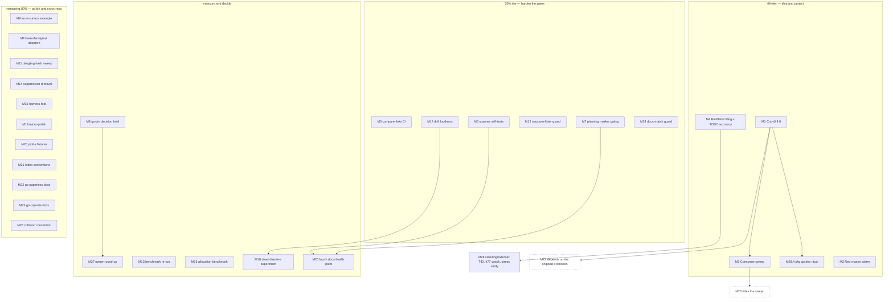

# Pareto Execution Plan: go-retry Post-Audit Release and Hardening Backlog

- **Created:** 2026-10-27 22:22 CET
- **Input:** `TODO_LIST.md` (24 open rows T42, T51–T54, T60, T77–T94), the
  2026-10-27 22:10 status report §f (50 items), the 2026-10-27 22:08
  concurrent-session report §b/§c (BuildFlow#77 filed; its open tails), and
  the ROADMAP open questions.
- **Method:** Pareto tiers (1 percent delivers 51 percent, 4 percent delivers
  64 percent, 20 percent delivers 80 percent, remaining 80 percent of work
  completes the 100 percent), then a comprehensive plan of 30–100 minute
  tasks, then a full breakdown into tasks of at most 12 minutes. All open
  TODOs are covered (coverage map at the end).
- **Repo state at planning time:** HEAD `ff196eb`, master synced with origin,
  CI green; `.buildflow.yml` removed (owner decision, BuildFlow#77 filed
  upstream); go pins intact (`go 1.26` root, `go 1.26.0` tools); gates green
  (race `-count=10`, lint 0 issues, coverage 100.0%, docs battery);
  `docs/status/` fully archived (23 reports) + one fresh 22:10 report and a
  concurrent 22:08 report awaiting their future annotation passes.

## Step 1: Pareto Breakdown

### The 1 percent that delivers 51 percent

**Cut v0.9.0 and run the consumer sweep (T77).** The last-attempt code
promotion (issue #3) is implemented, tested, and documented — and delivered
zero consumer value because no release carries it. go-paperless is blocked on
exactly this cut, the jitter godoc examples render only from the next tag,
and the consumer sweep is release-coupled by the Testing Patterns ritual. One
release train (M1 + M2) converts the whole quarter's library work into
consumer value and unblocks three downstream items. Nothing else on the board
moves a consumer.

### The 4 percent that delivers 64 percent

The 1 percent item plus three protectors:

1. **Red-master alarm (T78).** Twelve days of red master (2026-10-15 → 27)
   and ten unread nightly-stress failures prove "CI exists" is not "CI is
   watched". A repo-local watchdog that fails loudly on non-green master
   protects every future release train (M3).
2. **Finish the BuildFlow upstream filing (T85 remainder).** BuildFlow#77
   (go-mod-update pin-blindness) is filed; the dry-run-writes bug is not.
   Filing while the repro evidence is fresh converts this repo's incident
   class into fleet-level fixes (M4).
3. **Compare-links as a CI step (T81).** A poisoned compare link currently
   fails the release, not the push — the cheapest gate with the widest
   blast-radius reduction (M5).

### The 20 percent that delivers 80 percent

The 4 percent items plus the gate-and-measure block: docs-gate scanner
self-tests (T79), planning-dir marker gating (T80), the go-pin decision brief
(owner decision prep), the two benchmarks (T83 re-run, T89 allocation), drift
loudness (T94), the dead-directive experiment (T92), the structure-linter
guard (T82), and the small code-quality set (T87 example, T88 assertion
helpers, T90 harness fold). These harden the systems this audit just leaned
on.

### The remaining 80 percent of work (to reach 100 percent)

Everything else: archive integrity (T53 dangling hashes), probe fixtures
(T51), index/backlog conventions (T52), docs-match go-version guard (T54),
cross-repo doc fixes (T86 go-paperless, T91 go-cqrs-lite), micro-polish
(T93), external-gated standers (T42 Dependabot watch, T60 — now stale and
slated for retirement, see M4), the nightly-stress verification, the fourth
docs-health point, the collision convention, the owner-decision round-up, and
the post-release rituals.

## Step 2: Comprehensive Plan (30–100 min tasks, all TODOs covered, impact-sorted)

| #   | Tier | Task                                                                                                                                                                                                                          | Covers            | Impact   | Effort        | Customer value |
| --- | ---- | ----------------------------------------------------------------------------------------------------------------------------------------------------------------------------------------------------------------------------- | ----------------- | -------- | ------------- | -------------- |
| M1  | P0   | Cut v0.9.0: pre-release battery, govulncheck root + `tools/`, CHANGELOG date-out, annotated tag, push, GitHub-only notes, proxy/pkg.go.dev verify                                                                             | T77               | Critical | 90m           | High           |
| M2  | P0   | Consumer sweep: bump go-cqrs-lite `middleware/` to v0.9.0, four `-race` suites, ROADMAP bump-trace + matrix rows, capture the bump hash                                                                                       | T77               | High     | 60m           | High           |
| M3  | P0   | Red-master alarm: repo-local watchdog workflow that fails/pings on non-green master (required-checks option noted for the owner)                                                                                              | T78               | High     | 45m           | Medium         |
| M4  | P0   | BuildFlow upstream + ledger: file the dry-run-writes issue (repro first), add filed-issue links to ROADMAP, TODO accuracy pass (retire T60, narrow T85)                                                                       | T85, report tails | High     | 60m           | Medium         |
| M5  | P1   | `check-compare-links.sh` as a CI step in the lint job (after actionlint); actionlint + allowlist re-verify                                                                                                                    | T81               | Medium   | 30m           | Medium         |
| M6  | P1   | Docs-gate scanner self-tests: table-driven edge cases for the `docs_test.go` helpers, mutation-drilled                                                                                                                        | T79               | High     | 90m           | Medium         |
| M7  | P1   | Extend marker gating to `docs/planning/archived/*.md`; run over the four plans; fix or annotate gaps; prove-fail drill                                                                                                        | T80               | High     | 60m           | Medium         |
| M8  | P1   | Go-pin decision brief in `docs/engineering-notes.md` (hold vs deliberate 1.27 sweep, re-priced post-config-removal); link from the ROADMAP OQ                                                                                 | OQ                | High     | 30m           | Low            |
| M9  | P1   | `ExampleDoWithValue` error-surface example (promoted outermost code on failure), output-pinned, FEATURES row                                                                                                                  | T87               | Medium   | 30m           | Medium         |
| M10 | P1   | Adopt `errorfamilytest.AssertCode`/`AssertFamily` across the promotion tests                                                                                                                                                  | T88               | Medium   | 45m           | Low            |
| M11 | P2   | Dangling-hash sweep across `docs/planning/archived/` and `docs/status/archived/`; annotate or correct every unresolvable `done at`                                                                                            | T53               | Medium   | 45m           | Low            |
| M12 | P2   | Guard test pinning the `.go-structure-linter.yaml` go-version suppression (proven failing on drift)                                                                                                                           | T82               | Medium   | 45m           | Low            |
| M13 | P2   | Re-run `BenchmarkComputeDelay` on the current toolchain; update or confirm the FEATURES numbers                                                                                                                               | T83               | Medium   | 30m           | Low            |
| M14 | P2   | Check the deployed structure-linter version; if ≥ v0.11.3 remove the go-version suppression and re-run the step, else record the block                                                                                        | T84               | Low      | 30m           | Low            |
| M15 | P2   | Stress harness: fold the DoWithValue check into the same loop as the Do run; parity assertions; race + lint                                                                                                                   | T90               | Low      | 45m           | Low            |
| M16 | P2   | Benchmark the promoted-terminal extra allocation; record in FEATURES                                                                                                                                                          | T89               | Low      | 45m           | Low            |
| M17 | P2   | Drift loudness: pin the three `//art-dupl:accept` directive lines with a proven-failing guard (or strict invocation), re-decide warnings-gate                                                                                 | T94               | Medium   | 60m           | Low            |
| M18 | P2   | Dead-directive experiment: flip one directive hash byte, observe, restore; record the answer in engineering-notes                                                                                                             | T92               | Low      | 30m           | Low            |
| M19 | P2   | Micro-polish bundle: PreCanceled comment (T93) + the `reports/` one-liner in CONTRIBUTING                                                                                                                                     | T93, tails        | Low      | 30m           | Low            |
| M20 | P2   | Safe probe fixtures: gitignored scratch convention for guard drills; migrate the drill docs                                                                                                                                   | T51               | Medium   | 45m           | Low            |
| M21 | P2   | Index/backlog conventions: State/Verdict column canon, planning-README decision, document in the status README                                                                                                                | T52               | Medium   | 60m           | Low            |
| M22 | P2   | go-paperless: retire the `errors.AsType` workaround in its consumer docs (verify-before-filing)                                                                                                                               | T86               | Medium   | 45m           | Medium         |
| M23 | P2   | go-cqrs-lite docs sweep for the stale go.work claim (plus any `.buildflow.yml` assumptions, per the 22:08 report)                                                                                                             | T91               | Low      | 30m           | Low            |
| M24 | P3   | Docs-match go-version guard: living docs' stated Go version must equal `go.mod` (proven failing)                                                                                                                              | T54               | Low      | 45m           | Low            |
| M25 | P3   | Fourth docs-health point: rerun the audit shape, compute the drift trend against the 2026-10-27 baseline scores                                                                                                               | tails             | Medium   | 60m           | Low            |
| M26 | P3   | Concurrent-collision convention for `docs/status/` (two sessions annotating one report within an hour is now a real case)                                                                                                     | tails             | Low      | 30m           | Low            |
| M27 | P3   | Owner-decision round-up: one consolidated ask covering the eight standing ROADMAP questions                                                                                                                                   | OQs               | Medium   | 30m           | Medium         |
| M28 | P3   | External-gated standers: T42 Dependabot watch, T60 retirement check (premise verified stale by the 22:08 session), BuildFlow#77 fix-watch, nightly-stress verification on 2026-10-28 04:33 UTC, post-v0.9.0 pkg.go.dev ritual | T42, T60, tails   | Low      | 30m + waiting | Low            |

Coverage check: T42→M28, T51→M20, T52→M21, T53→M11, T54→M24, T60→M4/M28,
T77→M1+M2, T78→M3, T79→M6, T80→M7, T81→M5, T82→M12, T83→M13, T84→M14,
T85→M4, T86→M22, T87→M9, T88→M10, T89→M16, T90→M15, T91→M23, T92→M18,
T93→M19, T94→M17 — all 24 open TODO rows covered, plus the report tails.

## Step 3: Detailed Breakdown (every task at most 12 minutes, all todos, impact-sorted)

### P0

| ID   | Task                                                                                                               | Time |
| ---- | ------------------------------------------------------------------------------------------------------------------ | ---- |
| M1.1 | Pre-release battery: gofmt, vet root + `tools/`, race `-count=10`, lint + config verify, coverage line, check-docs | 12m  |
| M1.2 | `govulncheck ./...` on root AND `tools/`                                                                           | 12m  |
| M1.3 | CHANGELOG `[Unreleased]` date-out to `[0.9.0]` with fresh empty placeholders                                       | 12m  |
| M1.4 | Extend compare-links for v0.9.0; run `check-compare-links.sh`                                                      | 12m  |
| M1.5 | Annotated tag `v0.9.0`; push master + tag                                                                          | 12m  |
| M1.6 | GitHub Release composed from the `[0.9.0]` CHANGELOG section (GitHub-only policy)                                  | 12m  |
| M1.7 | Verify: proxy `go list -m -versions`, clean-room `go get @v0.9.0`, pkg.go.dev page, tag-CI green                   | 12m  |
| M1.8 | Refresh README/FEATURES version claims and badges post-release                                                     | 12m  |
| M2.1 | Bump `middleware/go.mod` to `go-retry v0.9.0`; capture the go-cqrs-lite commit hash                                | 12m  |
| M2.2 | `middleware` module suite with `-race`                                                                             | 12m  |
| M2.3 | `commandlifecycle` ritual suite with `-race`                                                                       | 12m  |
| M2.4 | `integration` ritual suite with `-race`                                                                            | 12m  |
| M2.5 | `example/taskmanager` ritual suite with `-race`                                                                    | 12m  |
| M2.6 | ROADMAP bump-trace row + compatibility-matrix row; hash into the ledger                                            | 12m  |
| M3.1 | Decide the watchdog shape (scheduled `gh run list` + fail loudly; required-checks option goes to the owner ask)    | 12m  |
| M3.2 | Write `.github/workflows/watchdog.yml` with already-allowlisted action pins                                        | 12m  |
| M3.3 | actionlint re-verify; extend `actionInputAllowlist` only if a new `uses:` appears                                  | 12m  |
| M3.4 | Prove-fail drill: simulate non-green master, observe the watchdog fail naming it, restore (`-count=1`)             | 12m  |
| M4.1 | Verify-before-filing: reproduce the dry-run-writes-`.golangci.yml` bug against current BuildFlow HEAD              | 12m  |
| M4.2 | File the dry-run-writes issue with the repro                                                                       | 12m  |
| M4.3 | Add the filed-issue links (BuildFlow#77 + the new issue) to the ROADMAP daemon-guard open question                 | 12m  |
| M4.4 | TODO accuracy pass: retire T60 (premise stale — binary verified == HEAD), narrow T85 to the remaining watch        | 12m  |

### P1

| ID    | Task                                                                                                  | Time |
| ----- | ----------------------------------------------------------------------------------------------------- | ---- |
| M5.1  | Add the `check-compare-links.sh` step to the `ci.yml` lint job after actionlint                       | 12m  |
| M5.2  | actionlint re-verify + allowlist test green + docs (AGENTS CI row, FEATURES CI bullet)                | 12m  |
| M6.1  | Table-driven cases for `stripInlineCode` (paired spans, unpaired runs, double-backticks)              | 12m  |
| M6.2  | Table-driven cases for `splitTableCells` (`\|` escapes, empty cells, trailing cells)                  | 12m  |
| M6.3  | Fence-detection cases (backtick/tilde fences, indented fences, nested-looking text)                   | 12m  |
| M6.4  | Unclosed-run preservation + unclosed code-span-in-cell cases                                          | 12m  |
| M6.5  | Lazy-continuation item-segmentation cases (blank-line continuation vs item end)                       | 12m  |
| M6.6  | Wire the self-tests into `docs_test.go`; full suite + lint                                            | 12m  |
| M6.7  | Mutation drill: break one scanner helper, observe the self-tests fail naming it, restore (`-count=1`) | 12m  |
| M7.1  | Extend `TestArchivedReportItemsCarryVerdicts` (or a sibling) to `docs/planning/archived`              | 12m  |
| M7.2  | Run the extended gate over the four plans; triage every finding                                       | 12m  |
| M7.3  | Annotate or disposition the gaps found in the older plans (format-only repairs; never content)        | 12m  |
| M7.4  | Prove-fail drill on the extended gate + status-README gates paragraph update                          | 12m  |
| M8.1  | Draft the go-pin brief: hold-vs-sweep costs, toolchain 1.26.8 nuance, upstream #77 dependency         | 12m  |
| M8.2  | Link the brief from the ROADMAP go-pin-endgame question; flag for the owner round-up (M27)            | 12m  |
| M9.1  | Write `ExampleDoWithValue_errorSurface`: coded last attempt, assert the promoted outermost code       | 12m  |
| M9.2  | Output-pin it; FEATURES examples row update; race suite                                               | 12m  |
| M10.1 | Swap the promotion tests' code/family assertions to `errorfamilytest` helpers                         | 12m  |
| M10.2 | Race suite + lint over the touched tests                                                              | 12m  |
| M10.3 | Drop now-unused imports/helpers; FEATURES guarantee row wording touch-up                              | 12m  |

### P2

| ID           | Task                                                                                                       | Time |
| ------------ | ---------------------------------------------------------------------------------------------------------- | ---- |
| M11.1        | Extract every `done at` hash from `docs/planning/archived/`                                                | 12m  |
| M11.2        | Resolve each via `git cat-file`; list the dangling ones                                                    | 12m  |
| M11.3        | Annotate dangling citations (corrected hash or explicit marker); spot-check three status-archive citations | 12m  |
| M12.1        | Write the suppression guard test (parses `.go-structure-linter.yaml`, asserts the go-version suppression)  | 12m  |
| M12.2        | Prove-fail drill on injected drift (`-count=1`)                                                            | 12m  |
| M12.3        | CHANGELOG + FEATURES guard-list rows                                                                       | 12m  |
| M13.1        | Run `BenchmarkComputeDelay`; record ns/op and allocs on the current toolchain                              | 12m  |
| M13.2        | Update FEATURES or record "unchanged"; note the re-check condition                                         | 12m  |
| M14.1        | Query the deployed structure-linter version against v0.11.3                                                | 12m  |
| M14.2        | Remove the suppression and re-run the step, or record the block with the re-check condition                | 12m  |
| M15.1        | Fold the DoWithValue consistency check into the stress harness's Do loop                                   | 12m  |
| M15.2        | Assertion parity check; race suite `-count=10`                                                             | 12m  |
| M15.3        | Lint + coverage line; FEATURES stress-row wording if needed                                                | 12m  |
| M16.1        | Add the terminal-allocation benchmark (coded vs uncoded last attempt)                                      | 12m  |
| M16.2        | Record the numbers in FEATURES (next to the promotion row)                                                 | 12m  |
| M16.3        | Lint + suite                                                                                               | 12m  |
| M17.1        | Decide the shape: guard pinning the three directive lines vs strict art-dupl invocation                    | 12m  |
| M17.2        | Implement the guard (proven failing on a drifted hash, `-count=1`)                                         | 12m  |
| M17.3        | Wire into the battery; CHANGELOG entry; engineering-notes note                                             | 12m  |
| M18.1        | Flip one `//art-dupl:accept` hash byte; run art-dupl; observe; restore                                     | 12m  |
| M18.2        | Record the dead-directive answer in `docs/engineering-notes.md`                                            | 12m  |
| M19.1        | Add the deliberate-difference comment to `TestDo_PreCanceledContextReturnsErrCanceled`                     | 12m  |
| M19.2        | Add the `reports/` one-liner to CONTRIBUTING's coverage section                                            | 12m  |
| M20.1        | Define the gitignored scratch-probe convention (`.gitignore` + docs)                                       | 12m  |
| M20.2        | Point the guard-drill docs at the convention                                                               | 12m  |
| M20.3        | AGENTS pointer update (budget: one line out for one line in)                                               | 12m  |
| M21.1        | Draft the State/Verdict column canon for archived indexes and plans                                        | 12m  |
| M21.2        | Decide the planning-README question; implement (README or documented decline)                              | 12m  |
| M21.3        | Document the conventions in the status README; TODO_LIST T52 retirement                                    | 12m  |
| M22.1        | Locate the `errors.AsType` workaround teaching in go-paperless's consumer docs                             | 12m  |
| M22.2        | Rewrite it against the promotion (verify-before-filing at their source)                                    | 12m  |
| M22.3        | Cross-link the go-retry version that fixed it; note the consumer bump                                      | 12m  |
| M23.1        | Grep go-cqrs-lite docs/config for the go.work claim and `.buildflow.yml` assumptions                       | 12m  |
| M23.2        | Fix what is present; record the sweep outcome                                                              | 12m  |
| M17/M18 note | Both feed the art-dupl posture decision recorded in TODO_LIST T94                                          |      |

### P3

| ID    | Task                                                                                                                                                                             | Time |
| ----- | -------------------------------------------------------------------------------------------------------------------------------------------------------------------------------- | ---- |
| M24.1 | Write the docs-match guard (assert the stated Go version in the living docs equals `go.mod`'s directive)                                                                         | 12m  |
| M24.2 | Prove-fail drill on a doctored doc string (`-count=1`)                                                                                                                           | 12m  |
| M24.3 | CHANGELOG entry; TODO_LIST T54 retirement                                                                                                                                        | 12m  |
| M25.1 | Rerun the docs-health VERIFY pass over the living docs                                                                                                                           | 12m  |
| M25.2 | HARVEST any new tails; annotate/archive resolvable reports                                                                                                                       | 12m  |
| M25.3 | Compute the drift trend against the 2026-10-27 baseline (Accuracy 7.0 / Fitness 7.75 as-found)                                                                                   | 12m  |
| M25.4 | Print the inline health report; route new findings                                                                                                                               | 12m  |
| M26.1 | Draft the collision convention (annotation ownership, re-check rules, daemon-race handling for reports)                                                                          | 12m  |
| M26.2 | Document it in the status README; TODO_LIST row if bounded work remains                                                                                                          | 12m  |
| M27.1 | Assemble the eight ROADMAP owner questions into one consolidated ask (go-pin, SECURITY SLA, per-push flake net, lychee, daemon guard, topology, dprint posture, commit messages) | 12m  |
| M27.2 | Record the answers where they land (ROADMAP decided-records; TODO_LIST rows)                                                                                                     | 12m  |
| M28.1 | Verify the nightly stress run green (2026-10-28 04:33 UTC) and note it in FEATURES                                                                                               | 12m  |
| M28.2 | T42: check for the next Dependabot actions-group PR; run the verify-then-merge flow if open                                                                                      | 12m  |
| M28.3 | Watch BuildFlow#77; when a fix lands, verify it and strip the interim-exposure doc notes                                                                                         | 12m  |
| M28.4 | Post-v0.9.0 pkg.go.dev ritual: examples section, corpus-mirror guard                                                                                                             | 12m  |
| M28.5 | T60 formal retirement: confirm the binary == HEAD once more, strike the row in the next TODO pass                                                                                | 12m  |

## Execution Graph

Reading order: the ship tier first (M1 → M2 unblocks M22, M23, M28.4);
protectors M3–M5 in parallel with it; the gate tier (M6, M7, M12, M17, M24)
next — M6 and M7 feed the fourth audit (M25); the measure tier (M8, M13,
M16, M18) feeds the owner round-up (M27); the polish tier fills any remaining
capacity; M28 is external-gated standing work.

## Coverage and discipline notes

- Every open TODO row is covered exactly once (map under Step 2).
- The plan deliberately does NOT schedule the eight owner decisions as
  executable tasks — they are decision gates; M8 and M27 prepare and
  consolidate them.
- Repo invariants respected throughout: consumer sweeps bump the
  `middleware/` pin (the committed go.work does not list this repo); the
  release follows the go-release discipline (CHANGELOG cut, govulncheck on
  root + `tools/`, annotated tag, GitHub-only notes); new workflow pins are
  SHA-verified against `actionInputAllowlist` in the same change; guards are
  proven failing before they land; data-file drills always run `-count=1`.
